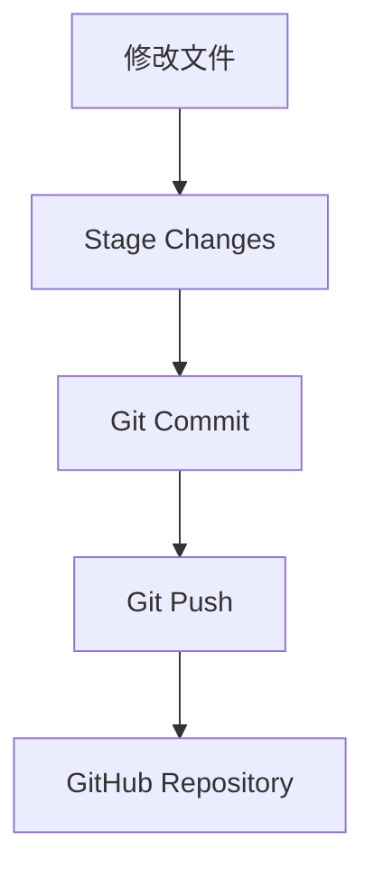
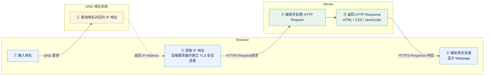
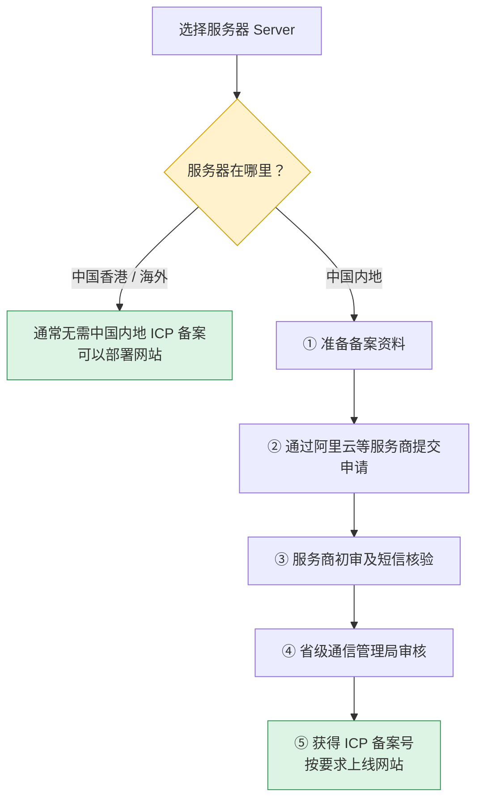

# Week 01 (10.12-10.13) | AI 实践学习日志

**时间：** 2026.10.12-10.13
**阶段：** Stage 0 - 搭建开发基础

## 做了什么

- **创建 GitHub Repository**
- **连接 GitHub 与 VS Code**
- **Git 版本控制尝试**
    - 将 GitHub 上创建的 AI-Marketing 仓库克隆到本地电脑。在 VS Code 中打开仓库，进行文件管理和编辑
    - **Git Stage**：在 VS Code 中创建 learning-journal/week-01.md 文件，将新增文件添加到暂存staging区
    - **Git Commit**：为暂存的文件修改添加 Commit Message；将修改记录到本地 Git 仓库，生成版本记录
    - **Git Push**：将本地Commit 推送到GitHub；已在 GitHub 网页中确认文件成功同步
- **用 Codex 尝试搭建个人网站**
    - 目前向 Codex 提出的需求较为笼统，只是尝试创建了一个能够正常打开的简单个人网页，没有对页面布局、配色或交互功能提出具体要求

        **目前的完成情况：**
        - 已成功使用 Codex 生成基础网页
        - 已能够在本地浏览器中查看网页
        - 网站目前只有初步结构，内容和功能比较简单
        - 尚未进行系统的UI设计和页面美化
        - 网站目前仅在本地运行，尚未部署到服务器
---

## 学了什么

### 1. Git 和 GitHub
#### Git
- 是什么：负责记录和管理文件的版本历史
- 运行位置：主要在本地电脑上
- 可独立使用
- 常见操作：Stage、Commit、Branch

#### Git基本工作流程：

#### Git Stage/Commit/Push的区别
- **Stage**：Stage 后，文件的修改会进入Staging Area，但还没有生成正式的版本记录
- **Commit**：把暂存区中的修改记录到本地Git仓库，形成一个可以追踪的历史版本。Commit 之后，GitHub网站上的内容不会自动更新，因为这次提交目前还保存在本地电脑上
- **Push**：把本地新创建的 Commit 上传到 GitHub。将本地提交同步到远程仓库。

#### GitHub
- 是什么：负责在线托管代码，方便同步和协作
- 运行位置：在线平台
- GitHub 主要用于托管 Git 仓库
- 常见操作：创建 Repository、Pull Request、代码协作

---

### 2. 网站运行流程
#### 有哪些概念（域名/DNS/IP/服务器/http）
- Domain域名：是网站在互联网上使用的名称，例如 `www.google.com` 
- Server服务器：是为其他计算机提供数据或服务的计算机或系统
- IP：网络地址
- DNS域名系统 ：域名解析的系统，帮助查询域名对应的 IP 地址等信息
- HTTP 与 HTTPS：超文本传输协议，规定客户端和服务器之间如何交换请求。https-加密

**我的理解：餐厅类比**

- **Domain（域名）** → 餐厅名称
- **DNS（域名系统）** → 地图导航，帮助查找地址
- **IP Address** → 餐厅地址
- **Server（服务器）** → 餐厅及其设施
- **Website（网站）** → 餐厅提供的菜单与服务

#### 流程

---
### 3. SSH（Secure Shell）
- 是什么：让我在自己的电脑上，通过互联网连接并操作远程服务器（Server）
- 作用：从 Mac 远程连接服务器;管理服务器上的文件和文件夹;安装和配置软件

#### 3.1 SSH Key（SSH 使用的一种身份验证方式）
- Public Key ：配置在远程服务器上，用于验证登录者的身份
- Private Key ：保存在本地电脑上，用于完成身份验证

#### 3.2 SSH ≠ HTTPS
- SSH 让我安全地远程登录和管理服务器，HTTPS 让普通用户安全地访问我的网站

---
### 4. ICP(Internet Content Provider) 备案
- **ICP备案流程**

- **为什么需要备案**
    - 登记网站运营主体和网站基本信息，明确相关责任

- **为什么香港和海外服务器通常不需要？**
    - ICP备案是中国大陆的特定管理制度。
    - 使用中国内地服务器提供网站服务，通常需要办理 ICP 备案；
    - 使用香港或海外服务器提供网站服务，一般不需要办理中国大陆的 ICP 备案

